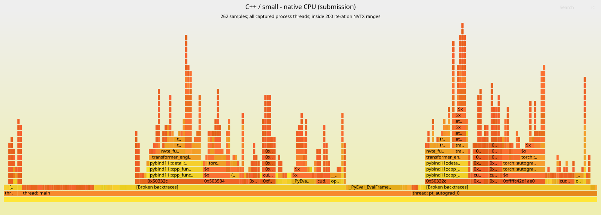
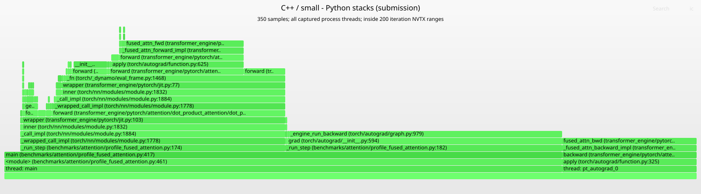
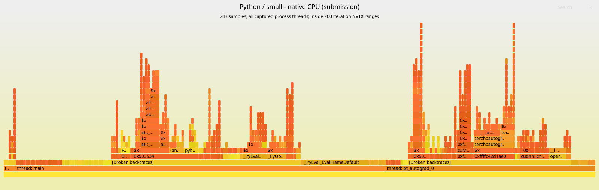
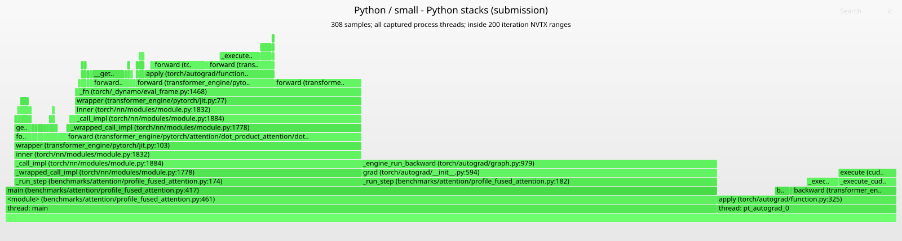
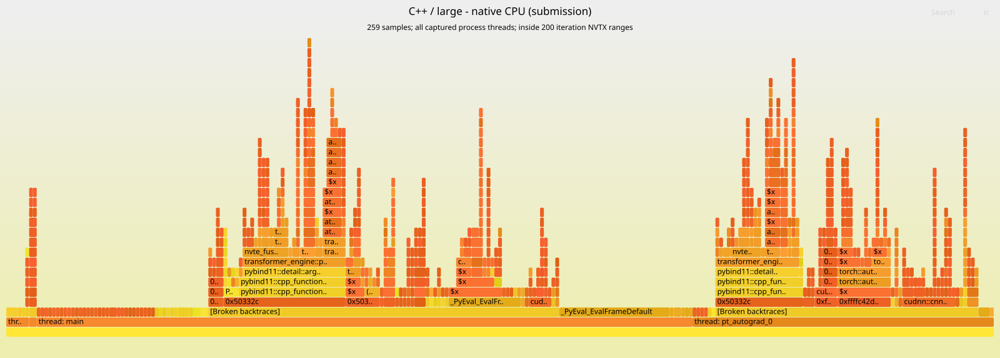
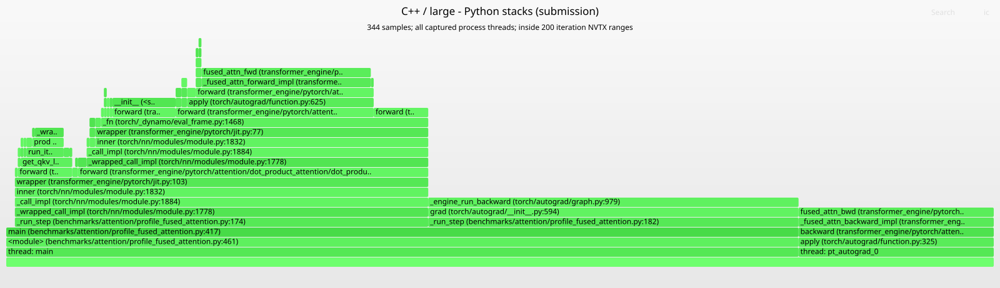
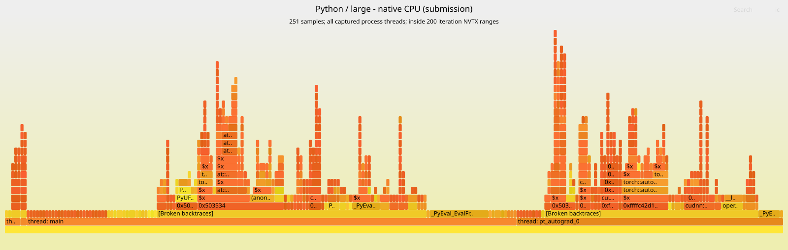
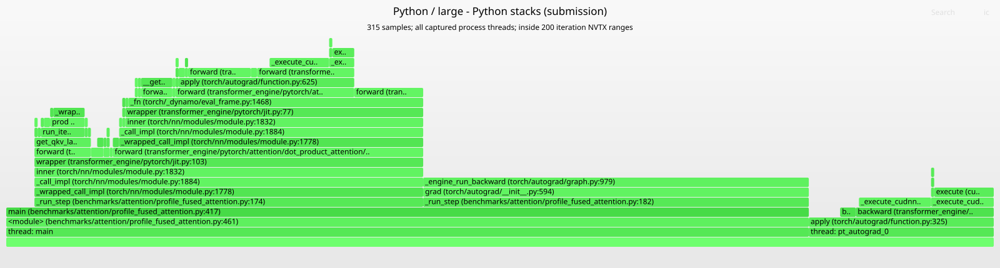

# C++ vs. Python cuDNN frontend: runtime and CPU sampling report

Capture date: 2026-09-30 (UTC)

Branch: `py-attn`

Source commit: `f8815da06f194cbceba689987a176ec62172d710`

## Findings

For this instrumented forward-plus-backward benchmark, Python has **5.40% lower wall time per step for the small shape**. The large-shape wall times differ by **0.12%**, with Python slightly slower. This is one capture per scenario, so the large-shape difference does not establish a performance ranking.

Both paths execute the same four GPU kernels per step for each shape. Small-shape GPU work is about 17.5 us/step and occupies only 2.4–2.5% of measured wall time. Host submission dominates this run. Large-shape GPU work is about 3.72 ms/step and occupies more than 99% of measured wall time. Submission runs ahead of the GPU, followed by one final queue drain.

The small-shape Python advantage is concentrated in the forward call: its mean CPU range is 49.9 us shorter; its backward call is 13.5 us longer. Those are inclusive host wall times, including profiling and any waiting during submission. Sampling identifies the call paths associated with those intervals, but cannot exclusively assign the timing difference to a specific allocation, cache lookup, or binding conversion.

## Branch and comparison scope

This branch adds `fused_attention_impl="python"` alongside TE's existing C++ fused-attention implementation. The Python path builds and caches cuDNN frontend SDPA graphs and supplies a PyTorch autograd implementation. The branch also removes zero-dropout RNG preparation from the C++ path, adds correctness coverage, and adds the profiling benchmark and repeated NVTX ranges.

These captures compare **warmed-cache runtime through the same PyTorch `DotProductAttention` API**. They include TE/PyTorch wrappers, autograd, tensor/buffer preparation, and cached cuDNN execution. They do not isolate frontend graph construction: all cuDNN graph construction during warmup is outside capture. `fwd_bwd` enables training, uses a forward graph with softmax statistics, and executes backward. This is not an inference-forward comparison.

## Environment

| Component | Value |
| --- | --- |
| GPU | NVIDIA GB200, device 0; idle before the runs |
| CPU / target architecture | ARM64 / AArch64, Linux SBSA |
| NVIDIA-SMI driver version | 580.159.04 |
| Nsight Systems | NVIDIA Nsight Systems version 2026.5.1.18-265138582488v0 |
| Nsight target binary | `/usr/local/cuda-13.4/NsightSystems-cli-2026.5.1/target-linux-sbsa-armv8/nsys` |
| CUDA toolkit / CUPTI | 13.4 |
| cuDNN runtime | 9.25.0 (`92500`) |
| cuDNN frontend Python package | 1.30.0 |
| Python | 3.12.3 |
| PyTorch | 2.14.0a0+4fdf77b940.nv26.08 |
| TE Python source | `/workspace/TransformerEngine/transformer_engine/` |
| TE extension | `transformer_engine_torch.cpython-312-aarch64-linux-gnu.so` from this checkout |

The extension was loaded from the checkout. Its exact compiled-source revision was not independently established by a rebuild in this session. No GPU clock locking or uninstrumented control runs were performed. Loaded CUDA driver-library names in the exports include `libcuda.so.615.65.02`; the table records the driver version reported by `nvidia-smi` rather than assuming those are identical.

## Methodology

### Workload and capture

| Parameter | Value |
| --- | --- |
| Small shape (B, S, H, D) | (1, 128, 1, 64) |
| Large shape (B, S, H, D) | (2, 4096, 128, 128) |
| Data / layout / mask | BF16 / BSHD / top-left causal |
| Dropout | 0 |
| Mode | Forward plus backward (`--mode fwd_bwd`) |
| Warmups / captured iterations | 20 / 200 per scenario |
| Execution | Queued iterations; no `--cpu-overhead` or per-iteration synchronization |
| Capture boundary | `cudaProfilerStart/Stop`, after warmup and before printing the summary |
| CPU sampling | Process tree, DWARF, period 1,696,496 hardware cycles, backtrace on every sample |
| Python sampling | 2,000 Hz |
| Tracing | CUDA, NVTX, OS runtime, cuDNN, and PyTorch function ranges |
| Run order | C++ small, Python small, C++ large, Python large; sequential |

The script forces TE's fused-attention backend by disabling FlashAttention and unfused attention, then selects `cpp` or `python`. It verifies that fused attention was selected. CUDA synchronization after the 20 warmups completes warmup work before capture starts. The final synchronization completes all 200 queued iterations before capture ends.

`--pytorch=functions-trace` adds module forward and selected PyTorch function ranges. The benchmark's own repeated `iteration`, `forward_call`, and `backward_call` ranges provide the paired timing boundaries. The installed PyTorch tracing preset omits `torch.autograd.grad`, which this benchmark uses; the explicit `backward_call` range covers it. No shape tracing or extra autograd instrumentation was requested. [Nsight PyTorch profiling documentation](https://docs.nvidia.com/nsight-systems/UserGuide/#pytorch-profiling)

### Exact profiling commands

Working directory: `/workspace/TransformerEngine`. The output directory was created beforehand. These are the four commands actually executed, with line breaks added for readability:

```bash
nsys profile \
  --capture-range=cudaProfilerApi \
  --capture-range-end=stop \
  --trace=cuda,nvtx,osrt,cudnn \
  --sample=process-tree \
  --backtrace=dwarf \
  --sampling-period=1696496 \
  --samples-per-backtrace=1 \
  --python-sampling=true \
  --python-sampling-frequency=2000 \
  --pytorch=functions-trace \
  --output=/workspace/TransformerEngine/profiling_artifacts/py_attn_f8815da0_w20_i200/cpp_small \
  python benchmarks/attention/profile_fused_attention.py \
    --impl cpp --shape small --measure runtime --mode fwd_bwd \
    --dtype bf16 --mask causal --device 0 \
    --warmup 20 --iterations 200 --profile

nsys profile \
  --capture-range=cudaProfilerApi \
  --capture-range-end=stop \
  --trace=cuda,nvtx,osrt,cudnn \
  --sample=process-tree \
  --backtrace=dwarf \
  --sampling-period=1696496 \
  --samples-per-backtrace=1 \
  --python-sampling=true \
  --python-sampling-frequency=2000 \
  --pytorch=functions-trace \
  --output=/workspace/TransformerEngine/profiling_artifacts/py_attn_f8815da0_w20_i200/python_small \
  python benchmarks/attention/profile_fused_attention.py \
    --impl python --shape small --measure runtime --mode fwd_bwd \
    --dtype bf16 --mask causal --device 0 \
    --warmup 20 --iterations 200 --profile

nsys profile \
  --capture-range=cudaProfilerApi \
  --capture-range-end=stop \
  --trace=cuda,nvtx,osrt,cudnn \
  --sample=process-tree \
  --backtrace=dwarf \
  --sampling-period=1696496 \
  --samples-per-backtrace=1 \
  --python-sampling=true \
  --python-sampling-frequency=2000 \
  --pytorch=functions-trace \
  --output=/workspace/TransformerEngine/profiling_artifacts/py_attn_f8815da0_w20_i200/cpp_large \
  python benchmarks/attention/profile_fused_attention.py \
    --impl cpp --shape large --measure runtime --mode fwd_bwd \
    --dtype bf16 --mask causal --device 0 \
    --warmup 20 --iterations 200 --profile

nsys profile \
  --capture-range=cudaProfilerApi \
  --capture-range-end=stop \
  --trace=cuda,nvtx,osrt,cudnn \
  --sample=process-tree \
  --backtrace=dwarf \
  --sampling-period=1696496 \
  --samples-per-backtrace=1 \
  --python-sampling=true \
  --python-sampling-frequency=2000 \
  --pytorch=functions-trace \
  --output=/workspace/TransformerEngine/profiling_artifacts/py_attn_f8815da0_w20_i200/python_large \
  python benchmarks/attention/profile_fused_attention.py \
    --impl python --shape large --measure runtime --mode fwd_bwd \
    --dtype bf16 --mask causal --device 0 \
    --warmup 20 --iterations 200 --profile
```

### Timing and attribution definitions

- **Wall time/step** is the complete outer benchmark NVTX duration divided by 200. It includes final GPU completion and the final synchronization return.
- **CUDA-event time/step** is the benchmark's aggregate stream event interval divided by 200, printed to three decimals. It includes GPU idle intervals between the events, not just kernel execution.
- **CPU iteration / forward / backward** are the durations of their corresponding NVTX ranges. These are host wall times, not exclusive on-core CPU time. The iteration includes both child calls and intervening bookkeeping; final queue drain is outside the individual iterations.
- **GPU work/step** is the sum of the 800 kernel durations divided by 200. Kernels are sequential on one device/stream in these exports. **GPU busy share** divides that sum by the outer wall duration; it is measured kernel occupancy of this window, not a device-wide utilization counter.
- **Native CPU function share** counts running IP samples at a function or in a recorded stack. Every exported `COMPOSITE_EVENTS.cpuCycles` weight is 1 in these captures, so percentages use sample counts. The configured trigger is hardware cycles, whose period is not a fixed wall-clock frequency. These are relative sampled CPU activity, not measured CPU milliseconds or core utilization.
- **Python leaf occupancy** counts samples whose deepest visible Python frame is the named function. Native work or waiting beneath that Python frame is included. **Python inclusive occupancy** counts samples with that function anywhere in the stack, once per sample even with recursion. Inclusive percentages overlap and must not be summed.

Native and Python streams have different sampling triggers and cannot be combined into a single percentage. Python sampler states such as `Running` and `Uninterruptible` are retained; they do not establish exclusive Python bytecode execution time.

The report uses two scopes. **Submission** keeps samples with timestamps inside one of the 200 outer iteration ranges. **Full measured window** also includes inter-iteration bookkeeping and the final queue drain. Both scopes include all captured process threads, including `main`, PyTorch's `pt_autograd_0` worker, and native samples from Nsight helper threads. Thread roots in the graphs make that distinction visible. Sampling only `main` would omit backward work performed by the autograd worker.

### Stack conversion and flamegraph generation

The unmodified NVIDIA helper was run on all four reports with full function names. It reads native CPU samples only; its SQL groups by leaf symbol and module and selects a representative caller stack for each group. Those original `*.cpu.folded` outputs are retained. **The attribution tables and graphs below use complete raw SQLite stacks**, preserving each sample's caller chain before folding identical full stacks. This avoids losing caller attribution in the original helper's leaf aggregation.

Python stacks are decoded from the `Python Periodic Sampling` JSON payloads in the NVTX export, resolving function/file IDs through `StringIds` and reversing leaf-first frames into root-first order. Function tables combine all lines of a function in the same file; graphs retain line numbers. Native graph labels shorten C++ signatures and template arguments using NVIDIA's name-shortening function; attribution by native function consequently combines those displayed overloads. Unknown addresses and broken-stack markers are retained.

The portable NVIDIA helper was extracted from the 2026.3.2 amd64 archive because the installed ARM CLI package lacks it. No package was installed and no amd64 binary ran. Every report and SQLite export used the installed ARM64 Nsight 2026.5.1 executable. The archive URL and SHA-256 are recorded in the artifact manifest.

The conversion and analysis commands, run from the repository root, are:

```bash
ARTIFACTS=/workspace/TransformerEngine/profiling_artifacts/py_attn_f8815da0_w20_i200

for scenario in cpp_small python_small cpp_large python_large; do
  nsys export --type=sqlite --include-json=true --dynamic-tables=all \
    --quiet=true --force-overwrite=true \
    --output="$ARTIFACTS/$scenario.sqlite" "$ARTIFACTS/$scenario.nsys-rep"
  python "$ARTIFACTS/tools/stackcollapse_nsys.py" \
    --nsys=/usr/local/cuda/bin --full_function_names \
    --out="$ARTIFACTS/$scenario.cpu.folded" "$ARTIFACTS/$scenario.nsys-rep"
done

python "$ARTIFACTS/tools/validate_and_fold_python.py" "$ARTIFACTS"
python "$ARTIFACTS/tools/analyze_report.py" "$ARTIFACTS"
python "$ARTIFACTS/tools/attribute_flamegraphs.py" "$ARTIFACTS"
python "$ARTIFACTS/tools/build_sampling_report.py" "$ARTIFACTS"
```

The last command uses Brendan Gregg's `flamegraph.pl` to render submission and full-window SVGs for each sampling stream. The exact 16 rendering commands are saved in `flamegraph_commands.sh`. For example, the C++ small native submission graph is rendered with:

```bash
perl /workspace/TransformerEngine/profiling_artifacts/py_attn_f8815da0_w20_i200/tools/flamegraph.pl --width=1600 --fontsize=12 --minwidth=0.1 --hash --colors=hot --countname=samples '--title=C++ / small - native CPU (submission)' '--subtitle=262 samples; all captured process threads; inside 200 iteration NVTX ranges' /workspace/TransformerEngine/profiling_artifacts/py_attn_f8815da0_w20_i200/cpp_small.cpu.submission.folded > /workspace/TransformerEngine/benchmarks/attention/fused_attention_python_vs_cpp_sampling_flamegraphs/cpp_small.cpu.submission.svg
```

## Measured results

| Shape | Implementation | Wall time/step (ms) | CUDA-event time/step (ms) | GPU work/step (us) | GPU busy share | Peak PyTorch allocation (GiB) |
| --- | --- | --- | --- | --- | --- | --- |
| small | C++ | 0.734456 | 0.735 | 17.468 | 2.38% | 0.000 |
| small | Python | 0.694775 | 0.695 | 17.484 | 2.52% | 0.000 |
| large | C++ | 3.729936 | 3.730 | 3723.301 | 99.82% | 3.508 |
| large | Python | 3.734459 | 3.735 | 3727.853 | 99.82% | 3.508 |

Small-shape `0.000 GiB` is the benchmark's rounded display, not zero memory use. All scenarios contain 800 kernels, or four per step. The kernel-name sets match between C++ and Python for each shape. No `extract_seed_and_offset` kernel was present. The two shape presets select different cuDNN kernels, so kernel names need not match across sizes.

### Inclusive CPU range times

| Scenario | Iteration mean / median (us) | Forward mean / median (us) | Backward mean / median (us) | After last iteration (ms) |
| --- | --- | --- | --- | --- |
| cpp_small | 732.295 / 725.553 | 408.241 / 408.080 | 298.368 / 293.984 | 0.109 |
| python_small | 692.831 / 679.185 | 358.370 / 358.800 | 311.869 / 304.369 | 0.090 |
| cpp_large | 717.179 / 713.857 | 403.562 / 404.384 | 289.371 / 285.424 | 602.248 |
| python_large | 704.299 / 697.937 | 368.244 / 362.577 | 312.655 / 304.225 | 605.739 |

“After last iteration” spans CUDA-event handling and the final synchronization until the outer NVTX range ends. For the large shape it is about 0.6 seconds: the host has submitted work faster than the GPU can execute it. That final wait explains why whole-window CPU/Python graphs emphasize synchronization rather than wrapper differences. CPU submission time and GPU time overlap, so adding them does not reconstruct step time.

## CPU attribution summary

### Sample coverage

| Scenario | Native samples in report | Native submission samples | Python samples in report | Python submission samples | Named native leaf | Native stack has broken marker |
| --- | --- | --- | --- | --- | --- | --- |
| cpp_small | 279 | 262 | 351 | 350 | 101 (38.5%) | 172 (65.6%) |
| python_small | 260 | 243 | 310 | 308 | 126 (51.9%) | 148 (60.9%) |
| cpp_large | 1419 | 259 | 1516 | 344 | 114 (44.0%) | 164 (63.3%) |
| python_large | 1426 | 251 | 1490 | 315 | 111 (44.2%) | 161 (64.1%) |

The last two columns describe submission native samples. A broken marker means some caller ancestry could not be unwound; useful frames can still exist in the same stack. A named leaf excludes unresolved addresses, ARM mapping symbols such as `$x`, and synthetic markers. Both limitations constrain precise native function attribution. The roughly 250 native and 300–350 Python submission samples per scenario support broad call-path observations, not precise rankings of tiny functions.

### Native CPU: exclusive attribution by leaf module

Each native sample belongs to exactly one module group based on the module containing its instruction pointer. Module identity is usable even when the individual symbol is unresolved. Percentages use all submission native samples in that scenario and sum to approximately 100% after rounding. This includes profiling overhead visible inside the capture.

| Leaf module group | cpp_small | python_small | cpp_large | python_large |
| --- | --- | --- | --- | --- |
| CPython interpreter | 40.1% | 42.8% | 42.1% | 41.4% |
| PyTorch native libraries | 12.6% | 20.6% | 12.0% | 17.9% |
| Transformer Engine native libraries | 6.5% | 0.0% | 6.2% | 0.0% |
| cuDNN native libraries and Python extension | 4.6% | 6.6% | 4.6% | 6.0% |
| CUDA driver and runtime | 7.3% | 4.9% | 7.3% | 4.8% |
| System runtime and vDSO | 13.4% | 14.4% | 11.6% | 15.1% |
| Nsight and CUPTI instrumentation | 14.1% | 9.1% | 13.5% | 12.0% |
| Other native modules | 1.5% | 1.6% | 2.7% | 2.8% |

CPython accounts for about 40–43% of native submission samples in every scenario. The Python path shifts visible native activity from TE's compiled wrapper into PyTorch libraries and cuDNN's Python extension. That module-level shift is consistent with the implementation structure, but does not establish which specific helper caused the measured timing change. Nsight/CUPTI modules themselves account for approximately 9–14% here, showing that these traces contain substantial instrumentation cost.

### Native CPU: selected inclusive function observations

Counts below are samples whose recorded stack contains the named function, including descendants. Missing caller ancestry can undercount them. Zero means no matching recorded frame, not that a function never executed. The rows overlap and do not sum to 100%.

| Function family | cpp_small | python_small | cpp_large | python_large |
| --- | --- | --- | --- | --- |
| `_PyEval_EvalFrameDefault` | 36 (13.7%) | 40 (16.5%) | 51 (19.7%) | 36 (14.3%) |
| `transformer_engine::pytorch::fused_attn_fwd` | 23 (8.8%) | 0 (0.0%) | 27 (10.4%) | 0 (0.0%) |
| `transformer_engine::pytorch::fused_attn_bwd` | 20 (7.6%) | 0 (0.0%) | 23 (8.9%) | 0 (0.0%) |
| `at::_ops::empty_memory_format::call` | 11 (4.2%) | 9 (3.7%) | 16 (6.2%) | 9 (3.6%) |
| `torch::autograd::Engine::execute` | 8 (3.1%) | 2 (0.8%) | 4 (1.5%) | 5 (2.0%) |

### Python: exclusive leaf occupancy by function group

This is the deepest visible Python frame, including native work or waits underneath it. Each Python sample belongs to one row. In particular, a sample at `_engine_run_backward` on the main thread can coexist with a sample executing attention backward on `pt_autograd_0`; both are retained and thread-labelled. These percentages must not be read as exclusive CPU bytecode time.

| Deepest Python frame group | cpp_small | python_small | cpp_large | python_large |
| --- | --- | --- | --- | --- |
| PyTorch Python and autograd | 41.4% | 50.6% | 40.7% | 44.4% |
| TE attention and wrappers | 47.7% | 15.6% | 47.1% | 10.5% |
| TE Python cuDNN implementation | 0.0% | 19.5% | 0.0% | 24.4% |
| cuDNN frontend Python bindings | 0.0% | 7.8% | 0.0% | 8.6% |
| Other Python frames | 10.9% | 6.5% | 12.2% | 12.1% |

The Python implementation exposes `cudnn_attention.forward/backward`, `_execute_cudnn_graph`, and `cudnn._pygraph.execute` frames. The C++ path instead exposes `cpp_extensions.fused_attn.fused_attn_fwd/bwd` as its deepest Python entry into compiled work. Sample occupancy at those entry points includes execution below the Python boundary; it cannot distinguish argument preparation, buffer allocation, driver submission, and GPU waiting without the corresponding native stack or phase instrumentation.

### Why full-window graphs look different

| Scenario | Full-window native samples | Full-window Python samples | Python leaf at final CUDA synchronization |
| --- | --- | --- | --- |
| cpp_small | 263 | 351 | 0 (0.0%) |
| python_small | 245 | 310 | 0 (0.0%) |
| cpp_large | 1413 | 1516 | 1170 (77.2%) |
| python_large | 1412 | 1490 | 1175 (78.9%) |

The large runs spend most Python sampled occupancy in the final `torch.cuda.synchronize`. Native stacks often retain `cudaDeviceSynchronize` / `cuCtxSynchronize_v2` ancestors despite unresolved internal driver frames. That is queue-completion behavior after submission, not additional Python frontend graph-building overhead.

## Flame graphs and per-scenario function attribution

Each scenario embeds a native CPU submission graph and a Python submission graph. Their widths are independently normalized to that graph's sample total. Box width represents sampled stack weight; height represents stack depth; horizontal position is stack grouping, not chronological time. Colors identify functions and carry no timing or severity meaning. Full-window alternatives are linked below each scenario.

Markdown image embedding provides a static preview. Open an SVG directly in a browser for the renderer's function tooltips, click-to-zoom, and search. Whether those controls work inside a document preview depends on the renderer's SVG scripting policy. The adjacent links remain available when an application cannot embed SVGs. [FlameGraph renderer and interaction documentation](https://github.com/brendangregg/FlameGraph)

### C++ — small shape

Native submission graph: **262 running CPU samples**. Python submission graph: **350 Python stack samples**, including all sampler states.

The Python entry points into compiled forward and backward are visible separately, with backward execution on `pt_autograd_0`. The native graph exposes compiled descendants where symbols and unwinding are available.

| Python function (file::function) | Leaf occupancy | Inclusive occupancy |
| --- | --- | --- |
| `torch/autograd/graph.py::_engine_run_backward` | 139 (39.7%) | 139 (39.7%) |
| `transformer_engine/pytorch/cpp_extensions/fused_attn.py::fused_attn_bwd` | 68 (19.4%) | 68 (19.4%) |
| `transformer_engine/pytorch/cpp_extensions/fused_attn.py::fused_attn_fwd` | 61 (17.4%) | 62 (17.7%) |
| `transformer_engine/pytorch/attention/dot_product_attention/backends.py::forward` | 27 (7.7%) | 111 (31.7%) |
| `<string>::__init__` | 17 (4.9%) | 17 (4.9%) |
| `benchmarks/attention/profile_fused_attention.py::main` | 8 (2.3%) | 282 (80.6%) |

**Native CPU submission**



[Open SVG](fused_attention_python_vs_cpp_sampling_flamegraphs/cpp_small.cpu.submission.svg)

**Python sampled submission**



[Open SVG](fused_attention_python_vs_cpp_sampling_flamegraphs/cpp_small.python.submission.svg)

Full measured-window views: [native CPU](fused_attention_python_vs_cpp_sampling_flamegraphs/cpp_small.cpu.full.svg), [Python stacks](fused_attention_python_vs_cpp_sampling_flamegraphs/cpp_small.python.full.svg).

### Python — small shape

Native submission graph: **243 running CPU samples**. Python submission graph: **308 Python stack samples**, including all sampler states.

The Python graph exposes the cached cuDNN graph execution path, including variant-pack/binding preparation and execution entry points. These are warmed-cache paths; the sampling does not show repeated graph construction.

| Python function (file::function) | Leaf occupancy | Inclusive occupancy |
| --- | --- | --- |
| `torch/autograd/graph.py::_engine_run_backward` | 123 (39.9%) | 123 (39.9%) |
| `transformer_engine/pytorch/attention/dot_product_attention/backends.py::forward` | 32 (10.4%) | 98 (31.8%) |
| `transformer_engine/pytorch/attention/dot_product_attention/cudnn_frontend.py::_execute_cudnn_graph` | 25 (8.1%) | 50 (16.2%) |
| `transformer_engine/pytorch/attention/dot_product_attention/cudnn_attention.py::forward` | 24 (7.8%) | 43 (14.0%) |
| `cudnn/_pygraph.py::execute` | 24 (7.8%) | 24 (7.8%) |
| `torch/autograd/function.py::apply` | 22 (7.1%) | 110 (35.7%) |

**Native CPU submission**



[Open SVG](fused_attention_python_vs_cpp_sampling_flamegraphs/python_small.cpu.submission.svg)

**Python sampled submission**



[Open SVG](fused_attention_python_vs_cpp_sampling_flamegraphs/python_small.python.submission.svg)

Full measured-window views: [native CPU](fused_attention_python_vs_cpp_sampling_flamegraphs/python_small.cpu.full.svg), [Python stacks](fused_attention_python_vs_cpp_sampling_flamegraphs/python_small.python.full.svg).

### C++ — large shape

Native submission graph: **259 running CPU samples**. Python submission graph: **344 Python stack samples**, including all sampler states.

The Python entry points into compiled forward and backward are visible separately, with backward execution on `pt_autograd_0`. The native graph exposes compiled descendants where symbols and unwinding are available.

| Python function (file::function) | Leaf occupancy | Inclusive occupancy |
| --- | --- | --- |
| `torch/autograd/graph.py::_engine_run_backward` | 129 (37.5%) | 129 (37.5%) |
| `transformer_engine/pytorch/cpp_extensions/fused_attn.py::fused_attn_bwd` | 68 (19.8%) | 68 (19.8%) |
| `transformer_engine/pytorch/cpp_extensions/fused_attn.py::fused_attn_fwd` | 59 (17.2%) | 59 (17.2%) |
| `<string>::__init__` | 23 (6.7%) | 23 (6.7%) |
| `transformer_engine/pytorch/attention/dot_product_attention/backends.py::forward` | 23 (6.7%) | 114 (33.1%) |
| `numpy/_core/fromnumeric.py::_wrapreduction` | 11 (3.2%) | 11 (3.2%) |

**Native CPU submission**



[Open SVG](fused_attention_python_vs_cpp_sampling_flamegraphs/cpp_large.cpu.submission.svg)

**Python sampled submission**



[Open SVG](fused_attention_python_vs_cpp_sampling_flamegraphs/cpp_large.python.submission.svg)

Full measured-window views: [native CPU](fused_attention_python_vs_cpp_sampling_flamegraphs/cpp_large.cpu.full.svg), [Python stacks](fused_attention_python_vs_cpp_sampling_flamegraphs/cpp_large.python.full.svg).

### Python — large shape

Native submission graph: **251 running CPU samples**. Python submission graph: **315 Python stack samples**, including all sampler states.

The Python graph exposes the cached cuDNN graph execution path, including variant-pack/binding preparation and execution entry points. These are warmed-cache paths; the sampling does not show repeated graph construction.

| Python function (file::function) | Leaf occupancy | Inclusive occupancy |
| --- | --- | --- |
| `torch/autograd/graph.py::_engine_run_backward` | 123 (39.0%) | 123 (39.0%) |
| `transformer_engine/pytorch/attention/dot_product_attention/cudnn_frontend.py::_execute_cudnn_graph` | 42 (13.3%) | 70 (22.2%) |
| `transformer_engine/pytorch/attention/dot_product_attention/cudnn_attention.py::forward` | 28 (8.9%) | 56 (17.8%) |
| `cudnn/_pygraph.py::execute` | 26 (8.3%) | 28 (8.9%) |
| `transformer_engine/pytorch/attention/dot_product_attention/backends.py::forward` | 22 (7.0%) | 92 (29.2%) |
| `numpy/_core/fromnumeric.py::_wrapreduction` | 11 (3.5%) | 11 (3.5%) |

**Native CPU submission**



[Open SVG](fused_attention_python_vs_cpp_sampling_flamegraphs/python_large.cpu.submission.svg)

**Python sampled submission**



[Open SVG](fused_attention_python_vs_cpp_sampling_flamegraphs/python_large.python.submission.svg)

Full measured-window views: [native CPU](fused_attention_python_vs_cpp_sampling_flamegraphs/python_large.cpu.full.svg), [Python stacks](fused_attention_python_vs_cpp_sampling_flamegraphs/python_large.python.full.svg).

## Validation and limits

Every scenario has 200 completed iteration ranges, 200 forward ranges, 200 backward ranges, 800 GPU kernels, and 1,000 PyTorch function ranges. Both sampling streams are nonempty. Folded totals were checked against the underlying selected sample records. All 16 SVGs were parsed as valid XML and contain the renderer's interaction controls.

Nsight emitted warnings that some CUDA, NVTX, or OS runtime events might not have been collected, plus cuBLASLt symbol-loading warnings. The expected benchmark ranges and kernel counts are present, but that count check does not prove every ancillary event was collected. Native symbolization/unwinding is incomplete as quantified above. Detailed diagnostics are retained in `validation.json`.

Each scenario was captured once, in a fixed order, under sampling and tracing. No uninstrumented baseline, repeated trial confidence interval, or clock-controlled comparison is available. Consequently, the small-shape advantage is an observation in these matched instrumented captures, while the 0.12% large-shape difference is too small to rank the APIs reliably. Percentages from a few hundred submission samples have limited precision. Native addresses are process-specific and should not be compared by numeric address across reports.

The most useful follow-up for optimization would be repeated uninstrumented timings, followed by targeted instrumentation of cache-key construction, allocation, variant-pack/binding conversion, and graph execution. The present evidence locates broad call paths and the forward/backward timing split; it does not exclusively price each internal helper.

## Artifacts

Raw captures, SQLite exports, original NVIDIA-helper outputs, derived full-stack folds, metadata, and scripts are in [`../../profiling_artifacts/py_attn_f8815da0_w20_i200/`](../../profiling_artifacts/py_attn_f8815da0_w20_i200/). The relative links require that artifact directory to accompany this checkout. Embedded SVGs are stored next to this report and remain available independently of the raw captures.

| Scenario | Nsight report | CPU submission stacks | Python submission stacks |
| --- | --- | --- | --- |
| cpp_small | [report](../../profiling_artifacts/py_attn_f8815da0_w20_i200/cpp_small.nsys-rep) | [folded](../../profiling_artifacts/py_attn_f8815da0_w20_i200/cpp_small.cpu.submission.folded) | [folded](../../profiling_artifacts/py_attn_f8815da0_w20_i200/cpp_small.python.submission.folded) |
| python_small | [report](../../profiling_artifacts/py_attn_f8815da0_w20_i200/python_small.nsys-rep) | [folded](../../profiling_artifacts/py_attn_f8815da0_w20_i200/python_small.cpu.submission.folded) | [folded](../../profiling_artifacts/py_attn_f8815da0_w20_i200/python_small.python.submission.folded) |
| cpp_large | [report](../../profiling_artifacts/py_attn_f8815da0_w20_i200/cpp_large.nsys-rep) | [folded](../../profiling_artifacts/py_attn_f8815da0_w20_i200/cpp_large.cpu.submission.folded) | [folded](../../profiling_artifacts/py_attn_f8815da0_w20_i200/cpp_large.python.submission.folded) |
| python_large | [report](../../profiling_artifacts/py_attn_f8815da0_w20_i200/python_large.nsys-rep) | [folded](../../profiling_artifacts/py_attn_f8815da0_w20_i200/python_large.cpu.submission.folded) | [folded](../../profiling_artifacts/py_attn_f8815da0_w20_i200/python_large.python.submission.folded) |

Machine-readable results: [analysis](../../profiling_artifacts/py_attn_f8815da0_w20_i200/report_analysis.json), [validation](../../profiling_artifacts/py_attn_f8815da0_w20_i200/validation.json), [capture manifest](../../profiling_artifacts/py_attn_f8815da0_w20_i200/manifest.json), [report-generation provenance](../../profiling_artifacts/py_attn_f8815da0_w20_i200/report_provenance.json).

Command files: [profiling](../../profiling_artifacts/py_attn_f8815da0_w20_i200/profile_commands.sh), [original conversion](../../profiling_artifacts/py_attn_f8815da0_w20_i200/convert_commands.sh), [SVG rendering](../../profiling_artifacts/py_attn_f8815da0_w20_i200/flamegraph_commands.sh).
